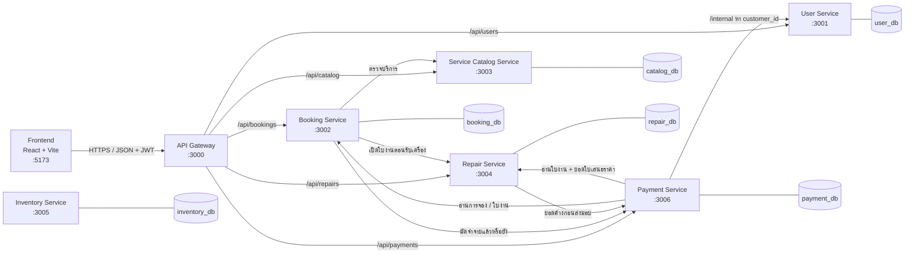
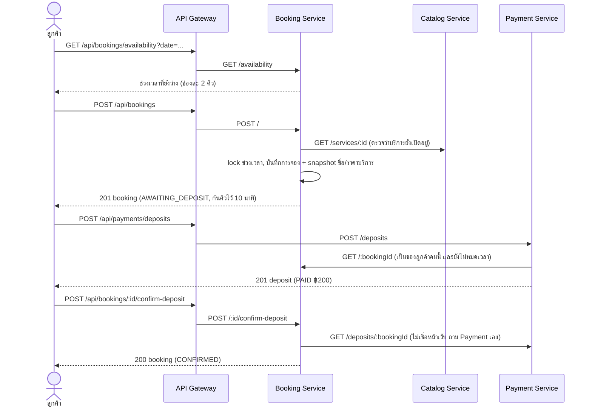

# Com-tle — SmartFix

รายชื่อ

-นาย รัชภูมิ ธรรมประชา 67159224

-นาย ศิวากร แทนทรัพย์ 67128056

-นาย สุรวุฒิ บุญยู้ 67144643

ระบบจัดการร้านซ่อมคอมพิวเตอร์ ออกแบบเป็น Microservices: ลูกค้าจองคิวออนไลน์และจ่ายมัดจำ ช่างเห็นคิวล่วงหน้าและรับงาน ร้านรับเครื่องและเปิดใบงานซ่อม ช่างวินิจฉัยและซ่อม ร้านออกใบเสนอราคา ลูกค้าอนุมัติและชำระเงินออนไลน์ได้

## Architecture

### ภาพรวม



- **ทุกคำขอจาก Frontend ผ่าน API Gateway จุดเดียว:** Gateway ส่งต่อเฉพาะ Endpoint ที่อยู่ใน allowlist ถ้าไม่อยู่ในรายการจะตอบ `404 API endpoint not found` (เช่น `/internal/...` เรียกจากภายนอกไม่ได้)
- **แต่ละบริการมีฐานข้อมูลของตัวเอง (Database per Service):** ใช้ MySQL 8 บน Railway บริการหนึ่งไม่อ่านตารางของอีกบริการโดยตรง ถ้าต้องใช้ข้อมูลข้ามบริการจะเรียกผ่าน HTTP API โดยส่งโทเคนของผู้เรียกต่อไปด้วย ปลายทางจึงตรวจสิทธิ์เองได้
- **ยืนยันตัวตนด้วย JWT (RS256):**
  - User Service เซ็นโทเคนด้วย private key (อายุ access token 15 นาที, refresh token 30 วันและหมุนทุกครั้งที่ใช้)
  - ทุกบริการตรวจโทเคนเองด้วย public key และตัดสินสิทธิ์จากบทบาทในโทเคน ไม่ต้องถาม User Service ทุกครั้ง
  - 1 บัญชีมี 1 บทบาท: `CUSTOMER`, `TECHNICIAN` หรือ `ADMIN`
- **เทคโนโลยี:** Node.js + Express, knex (migration/query), zod (validate input), jsonwebtoken, http-proxy-middleware (Gateway)

### หน้าที่ของแต่ละบริการ

| บริการ | Port | ฐานข้อมูล | หน้าที่ |
|---|---|---|---|
| API Gateway | 3000 | – | จุดเข้าเดียวของระบบ: ส่งต่อคำขอไปบริการที่ถูกต้อง, กรอง Endpoint ด้วย allowlist, จำกัดจำนวนครั้งการ login |
| User Service | 3001 | `user_db` | สมัครสมาชิก, เข้าสู่ระบบ, ออก/ต่ออายุ/ยกเลิกโทเคน, โปรไฟล์, บทบาทและสิทธิ์ (RBAC), ผู้ดูแลจัดการบัญชี (เปิด/ปิดบัญชี, เปลี่ยนบทบาท 1 บัญชี 1 บทบาท), รวมบัญชีลูกค้าที่ซ้ำ |
| Booking Service | 3002 | `booking_db` | ดูช่วงเวลาที่ว่าง, จองคิว (กันจองชนด้วย lock), **กันคิวไว้ระหว่างรอมัดจำ**, คิวงานที่จะเข้ามาให้ช่างรับล่วงหน้า, ยกเลิก / บันทึก "ไม่มาตามนัด" พร้อมเก็บประวัติสถานะ, รับเครื่อง (check-in) แล้วสั่งเปิดใบงานซ่อมให้ช่างที่รับงานไว้ |
| Service Catalog Service | 3003 | `catalog_db` | หมวดบริการและรายการบริการ พร้อมราคาเริ่มต้น (บาท) และเวลาโดยประมาณ, เปิด/ปิดบริการ, บันทึก audit log ทุกการแก้ไข |
| Repair Service | 3004 | `repair_db` | ใบงานซ่อม (Work Order) ทั้งจากการจองและ walk-in, มอบหมายช่าง, วินิจฉัย, ใบเสนอราคา (ส่ง/แก้ไข/ลูกค้าตัดสินใจ), ซ่อม, ทดสอบ, ส่งมอบ (เช็กยอดค้างกับ Payment), ยกเลิก, คลังอะไหล่และการเบิก |
| Inventory Service | 3005 | `inventory_db` | คลังอะไหล่ (โครงพร้อมแล้ว ยังไม่เปิดผ่าน Gateway ตอนนี้ Repair Service ดูแลอะไหล่) |
| Payment Service | 3006 | `payment_db` | บิลตามใบงาน, รับชำระที่ร้าน (แบ่งจ่ายได้), **ชำระออนไลน์** (PromptPay/บัตร แบบจำลอง), **มัดจำการจอง ฿200** (คืน / ยึด / หักค่าซ่อม), ยอดค้างชำระ, ล็อกการชำระ, ยกเลิกรายการชำระ, คืนเงินแบบ 2 คน (ขอ → อนุมัติ → ดำเนินการ) |

### เส้นทางข้อมูล

**1. เข้าสู่ระบบ**

```
Frontend → POST /api/users/auth/login → Gateway (rate limit) → User Service
         ← access token (JWT, 15 นาที) + refresh token (30 วัน)
```

Frontend แนบ `Authorization: Bearer <token>` ในทุกคำขอต่อจากนี้ ถ้า access token หมดอายุ Frontend ขอโทเคนใหม่ด้วย refresh token ให้อัตโนมัติ แล้วพาไปหน้าตามบทบาท: ลูกค้า → `/my/bookings`, ช่าง → `/tech`, ผู้ดูแล → `/admin`

**2. ลูกค้าจองคิวและจ่ายมัดจำ**



- Booking Service บันทึกชื่อและราคาบริการไว้กับการจอง (snapshot) ถ้าร้านแก้ราคาทีหลัง การจองเดิมก็ยังแสดงราคาตอนที่จอง
- ไม่จ่ายมัดจำภายใน 10 นาที → การจองถูกยกเลิกอัตโนมัติและคืนช่องเวลาให้คนอื่น
- จ่ายช้ากว่ากำหนดแต่ช่องเวลายังว่าง → ยังยืนยันให้ ถ้าช่องเต็มแล้ว → ยกเลิกและคืนมัดจำ

**3. ช่างรับงานล่วงหน้า**

```
ช่าง → GET  /api/bookings/queue              นัดวันนี้และพรุ่งนี้ที่ยืนยันแล้ว
ช่าง → POST /api/bookings/:id/claim          รับงาน (ใครกดก่อนได้ก่อน ช่างคนอื่นรับซ้ำได้ 409)
ช่าง → DELETE /api/bookings/:id/claim        คืนงานเข้าคิว (ผู้ดูแลก็ปล่อยงานได้)
```

**4. วันนัด: รับเครื่อง / ไม่มาตามนัด / ยกเลิก**

```
ลูกค้ามา   ผู้ดูแล → POST /api/bookings/:id/check-in
             Booking Service → POST Repair Service /work-orders  (Idempotency-Key: booking-<id>, ส่ง technician_user_id ของช่างที่รับงาน)
             ← work_order_id                                       (CONFIRMED → COMPLETED)
           → POST /api/payments/deposits/:bookingId/settle         มัดจำ APPLIED: นับเป็นเงินที่จ่ายแล้วของใบงาน

ไม่มา      ผู้ดูแล → PATCH /api/bookings/:id/no-show             (กดได้หลังเลยเวลานัด, CONFIRMED → NO_SHOW)
           → POST /api/payments/deposits/:bookingId/settle         มัดจำ FORFEITED: ร้านเก็บไว้

ยกเลิก     ลูกค้า (ก่อนเวลานัด) หรือผู้ดูแล (ต้องมีเหตุผล) → PATCH /api/bookings/:id/cancel
           → POST /api/payments/deposits/:bookingId/settle         มัดจำ REFUNDED: คืนเต็มจำนวน
```

- `settle` ให้ Payment อ่านสถานะการจองจาก Booking เอง แล้วคืน/ยึด/หักมัดจำให้ตรงกัน เรียกซ้ำได้ไม่เกิดผลซ้ำ
- กติกา 1 การจอง = 1 ใบงาน ถ้า Repair Service ล่ม การจองจะยังเป็น CONFIRMED แล้วลองใหม่ได้ ไม่เกิดใบงานซ้ำเพราะใช้ Idempotency-Key เดิม
- ลูกค้าที่ walk-in เข้ามาที่ร้านจะเปิดใบงานตรงที่ `POST /api/repairs/work-orders/walk-in`
- หน้าการจองของผู้ดูแลแสดงจำนวนครั้งที่ลูกค้าคนนั้นไม่มาตามนัด

**5. ซ่อม → เสนอราคา → ชำระเงิน → ส่งมอบ**

```
ช่างเริ่มวินิจฉัย / บันทึกผล / เสนอรายการซ่อมและอะไหล่ → ผู้ดูแลตั้งราคาและส่งใบเสนอราคา
ลูกค้าอนุมัติ/ปฏิเสธ (ร้านแก้เป็นฉบับใหม่ได้) → ช่างซ่อม (ร้านเบิกอะไหล่ตามที่อนุมัติ) → บันทึกผลซ่อม → ทดสอบ (ไม่ผ่าน = กลับไปซ่อม)
ยอดค้าง = ใบเสนอราคาที่อนุมัติ − ที่จ่ายแล้ว (รวมมัดจำ) + ที่คืนไป
ลูกค้าจ่ายออนไลน์ (POST /api/payments/checkout) หรือผู้ดูแลรับชำระที่ร้าน (แบ่งจ่ายได้)
ผู้ดูแลส่งมอบ → Repair Service ถามยอดค้างจาก Payment ก่อน (ยังค้าง = ต้องระบุเหตุผลข้อยกเว้น)
```

**6. คืนเงิน (ต้องใช้ผู้ดูแล 2 คน)**

```
ผู้ดูแล A → POST /api/payments/refunds                       ขอคืนเงิน (REQUESTED)
ผู้ดูแล B → POST /api/payments/refunds/:id/approve           อนุมัติ (คนขออนุมัติเองไม่ได้)
ผู้ดูแล B → POST /api/payments/refunds/:id/execute           ยืนยันว่าโอนคืนแล้ว (COMPLETED) ยอดในใบงานจึงเปลี่ยน
```

การคืนมัดจำตามกติกา (ยกเลิกก่อนนัด / ร้านยกเลิก) เป็นอัตโนมัติ ไม่ต้องผ่านขั้นนี้

**7. ถ้ามีบริการล่ม (Fault isolation)**

| บริการที่ล่ม | ผล |
|---|---|
| User Service | ผู้ใช้ที่ login อยู่ยังใช้งานได้ทุกอย่างรวมถึงเรื่องเงินจนโทเคนหมดอายุ (15 นาที) เพราะทุกบริการตรวจโทเคนเอง แต่ login ใหม่ไม่ได้ |
| Payment Service | หน้าใบงานและ Dashboard ยังเปิดได้ ส่วนการเงินแสดงว่า "ไม่พร้อมใช้งาน" |
| Catalog / Booking / Repair | เฉพาะฟีเจอร์ที่ต้องใช้บริการนั้นตอบ error ที่อ่านเข้าใจได้ ส่วนอื่นใช้งานต่อได้ |
| API Gateway | ใช้งานไม่ได้ทั้งระบบ (จุดเข้าเดียว) ระบบจริงแก้ด้วยการรันหลายตัวหลัง load balancer |

## API implementation

ทุก Endpoint เรียกผ่าน Gateway ที่ `http://localhost:3000/api` ตอบกลับเป็น JSON รูปแบบ `{ "success": true, "data": ... }` หรือ `{ "success": false, "message": "..." }` Endpoint ที่ต้อง login ให้แนบ `Authorization: Bearer <access token>` คำขอที่เกี่ยวกับเงิน (`POST /api/payments`, `/checkout`, `/deposits`, `/refunds`) ต้องแนบ `Idempotency-Key` เพื่อกันจ่ายซ้ำ

HTTP Methods ที่ใช้:

| Method | ใช้เมื่อ |
|---|---|
| `GET` | อ่านข้อมูล |
| `POST` | สร้างข้อมูลใหม่ หรือสั่งให้เกิดเหตุการณ์ เช่น check-in, จ่ายมัดจำ, รับงาน, คืนเงิน |
| `PUT` | บันทึกหรือแทนที่ข้อมูลทั้งก้อน เช่น ผลวินิจฉัย, ตั้งบทบาท |
| `PATCH` | แก้บางส่วน หรือเปลี่ยนสถานะ เช่น ยกเลิกการจอง, ไม่มาตามนัด, เปิด/ปิดบริการ |
| `DELETE` | ลบความสัมพันธ์ เช่น ช่างคืนงานที่รับไว้ |

### User Service — `/api/users`

| Method | Endpoint | ผู้ใช้ | คำอธิบาย |
|---|---|---|---|
| POST | `/api/users/auth/register` | ทุกคน | สมัครสมาชิก (ได้บทบาท CUSTOMER) |
| POST | `/api/users/auth/login` | ทุกคน | เข้าสู่ระบบ ได้ access + refresh token |
| POST | `/api/users/auth/refresh` | ผู้ใช้ | ขอ access token ใหม่ (refresh token เดิมใช้ซ้ำไม่ได้) |
| POST | `/api/users/auth/logout` | ผู้ใช้ | ออกจากระบบ (ยกเลิก refresh token) |
| GET | `/api/users/users/me` | ผู้ใช้ | ดูโปรไฟล์ตัวเอง |
| PATCH | `/api/users/users/me` | ผู้ใช้ | แก้โปรไฟล์ตัวเอง |
| GET | `/api/users/users/me/permissions` | ผู้ใช้ | ดูสิทธิ์ของตัวเอง |
| GET | `/api/users/admin/users` | ADMIN | รายชื่อผู้ใช้ (กรองด้วย `role`, `status`, `search`) |
| GET | `/api/users/admin/users/:userId` | ADMIN | ดูผู้ใช้หนึ่งคน |
| PATCH | `/api/users/admin/users/:userId/status` | ADMIN | เปิด/ปิดบัญชี |
| PUT | `/api/users/admin/users/:userId/roles/:roleCode` | ADMIN | ตั้งบทบาท CUSTOMER หรือ TECHNICIAN (แทนที่บทบาทเดิม เปลี่ยนบัญชีผู้ดูแลไม่ได้) |
| DELETE | `/api/users/admin/users/:userId/roles/:roleCode` | ADMIN | ถอนบทบาท (ถอนบทบาทสุดท้ายไม่ได้) |
| POST | `/api/users/admin/customer-merge-requests` | ADMIN | ขอรวมบัญชีลูกค้าที่ซ้ำกัน |
| POST | `/api/users/admin/customer-merge-requests/:requestId/approve` | ADMIN | อนุมัติการรวมบัญชี |
| POST | `/api/users/admin/customer-merge-requests/:requestId/reject` | ADMIN | ปฏิเสธการรวมบัญชี |
| POST | `/api/users/admin/customer-merge-requests/:requestId/cancel` | ADMIN | ยกเลิกคำขอรวมบัญชี |

Endpoint ภายใน (เรียกได้เฉพาะระหว่างบริการด้วยโทเคนภายใน ไม่ผ่าน Gateway): `POST /internal/customers/resolve` (Payment ใช้หา `customer_id` ของลูกค้า), `POST /internal/permissions/check`

### Booking Service — `/api/bookings`

| Method | Endpoint | ผู้ใช้ | คำอธิบาย |
|---|---|---|---|
| GET | `/api/bookings/availability?date=YYYY-MM-DD` | CUSTOMER / ADMIN | ช่วงเวลาที่ยังว่างของวันนั้น |
| POST | `/api/bookings` | CUSTOMER | จองคิว (บริการ, วันที่, เวลา, อุปกรณ์, อาการ) ได้สถานะ AWAITING_DEPOSIT |
| POST | `/api/bookings/:bookingId/confirm-deposit` | เจ้าของการจอง | ยืนยันคิวหลังจ่ายมัดจำ (Booking ตรวจกับ Payment เอง) → CONFIRMED |
| GET | `/api/bookings/me` | CUSTOMER | การจองของฉัน |
| GET | `/api/bookings` | ADMIN | การจองทั้งหมด (กรองสถานะ/วันที่ได้) พร้อมจำนวนครั้งที่ลูกค้าไม่มาตามนัด |
| GET | `/api/bookings/:bookingId` | เจ้าของ / ADMIN | รายละเอียดการจอง + ประวัติสถานะ |
| GET | `/api/bookings/queue?days=2` | TECHNICIAN / ADMIN | คิวที่จะเข้ามา (วันนี้ + วันถัดไป) |
| POST | `/api/bookings/:bookingId/claim` | TECHNICIAN | รับงานล่วงหน้า |
| DELETE | `/api/bookings/:bookingId/claim` | ช่างที่รับงาน / ADMIN | คืนงานเข้าคิว |
| PATCH | `/api/bookings/:bookingId/cancel` | เจ้าของ (ก่อนเวลานัด) / ADMIN (ต้องมีเหตุผล) | ยกเลิกการจอง |
| PATCH | `/api/bookings/:bookingId/no-show` | ADMIN | บันทึกว่าลูกค้าไม่มาตามนัด (หลังเลยเวลานัด) |
| POST | `/api/bookings/:bookingId/check-in` | ADMIN | รับเครื่องและเปิดใบงานซ่อม (CONFIRMED → COMPLETED) |
| PATCH | `/api/bookings/:bookingId/confirm` | ADMIN | ยืนยันการจองเก่าที่ยังเป็น PENDING |

สถานะการจอง:

```
AWAITING_DEPOSIT ──จ่ายมัดจำ──> CONFIRMED ──check-in──> COMPLETED   (เปิดใบงานซ่อม)
      │                            │
      │ หมดเวลา 10 นาที / ยกเลิก     ├──ยกเลิก──> CANCELLED
      └────────────> CANCELLED      └──ไม่มาตามนัด──> NO_SHOW
```

### Service Catalog Service — `/api/catalog`

| Method | Endpoint | ผู้ใช้ | คำอธิบาย |
|---|---|---|---|
| GET | `/api/catalog/categories` | ทุกคน | หมวดบริการ |
| POST | `/api/catalog/categories` | ADMIN | เพิ่มหมวด |
| PATCH | `/api/catalog/categories/:categoryId` | ADMIN | แก้ชื่อ/รายละเอียดหมวด |
| PATCH | `/api/catalog/categories/:categoryId/status` | ADMIN | เปิด/ปิดหมวด |
| GET | `/api/catalog/services` | ทุกคน | รายการบริการ (ลูกค้าเห็นเฉพาะที่เปิดอยู่) |
| GET | `/api/catalog/services/:serviceId` | ทุกคน | รายละเอียดบริการ |
| POST | `/api/catalog/services` | ADMIN | เพิ่มบริการ (ราคาเริ่มต้นเป็นบาท, เวลาโดยประมาณ) |
| PATCH | `/api/catalog/services/:serviceId` | ADMIN | แก้บริการ |
| PATCH | `/api/catalog/services/:serviceId/status` | ADMIN | เปิด/ปิดบริการ |
| GET | `/api/catalog/audit-logs` | ADMIN | ประวัติการแก้ไขแค็ตตาล็อก |

### Repair Service — `/api/repairs`

| Method | Endpoint | ผู้ใช้ | คำอธิบาย |
|---|---|---|---|
| POST | `/api/repairs/work-orders` | Booking Service / ADMIN | เปิดใบงานจากการจอง (ส่ง `technician_user_id` มาด้วยได้ เพื่อมอบหมายช่างทันที) |
| POST | `/api/repairs/work-orders/walk-in` | ADMIN | เปิดใบงานลูกค้า walk-in |
| GET | `/api/repairs/work-orders` | ADMIN | ใบงานทั้งหมด |
| GET | `/api/repairs/work-orders/me` | CUSTOMER | ใบงานของฉัน |
| GET | `/api/repairs/work-orders/assigned` | TECHNICIAN | งานที่ได้รับมอบหมาย |
| GET | `/api/repairs/work-orders/:workOrderId` | ผู้เกี่ยวข้อง | รายละเอียดใบงาน |
| POST | `/api/repairs/work-orders/:workOrderId/assign` | ADMIN | มอบหมาย/เปลี่ยนช่าง |
| POST | `/api/repairs/work-orders/:workOrderId/diagnosis/start` | TECHNICIAN | เริ่มวินิจฉัย |
| PUT | `/api/repairs/work-orders/:workOrderId/diagnosis` | TECHNICIAN | บันทึกผลวินิจฉัย |
| POST | `/api/repairs/work-orders/:workOrderId/quotations` | ADMIN / TECHNICIAN | สร้างใบเสนอราคา (ช่างเสนอรายการ) |
| PUT | `/api/repairs/quotations/:quotationId/send` | ADMIN | ตั้งราคาและส่งใบเสนอราคาให้ลูกค้า |
| POST | `/api/repairs/quotations/:quotationId/revise` | ADMIN | แก้ใบเสนอราคา (สร้างฉบับใหม่) |
| POST | `/api/repairs/quotations/:quotationId/decision` | CUSTOMER / ADMIN (walk-in) | อนุมัติ/ปฏิเสธใบเสนอราคา |
| POST | `/api/repairs/work-orders/:workOrderId/repair/start` | TECHNICIAN | เริ่มซ่อม |
| PUT | `/api/repairs/work-orders/:workOrderId/repair/result` | TECHNICIAN | บันทึกผลการซ่อม |
| POST | `/api/repairs/work-orders/:workOrderId/tests` | TECHNICIAN | บันทึกผลทดสอบ (ไม่ผ่าน = กลับไปซ่อม) |
| POST | `/api/repairs/work-orders/:workOrderId/handover` | ADMIN | ส่งมอบเครื่องคืนลูกค้า (ตรวจยอดค้างกับ Payment) |
| POST | `/api/repairs/work-orders/:workOrderId/cancel` | ADMIN | ยกเลิกใบงาน |
| GET | `/api/repairs/parts` | ADMIN / TECHNICIAN | รายการอะไหล่และจำนวนคงเหลือ |
| POST | `/api/repairs/parts` | ADMIN | เพิ่มอะไหล่ |
| POST | `/api/repairs/parts/:partId/receive` | ADMIN | รับอะไหล่เข้าสต็อก |
| GET | `/api/repairs/parts/movements` | ADMIN | ประวัติการเคลื่อนไหวอะไหล่ |
| POST | `/api/repairs/work-orders/:workOrderId/parts/issue` | ADMIN | เบิกอะไหล่ใช้กับใบงาน (เฉพาะรายการที่ลูกค้าอนุมัติ, ช่างเป็นคนเสนอ) |

### Payment Service — `/api/payments`

| Method | Endpoint | ผู้ใช้ | คำอธิบาย |
|---|---|---|---|
| POST | `/api/payments/deposits` | CUSTOMER | จ่ายมัดจำการจอง ฿200 (PromptPay/บัตร แบบจำลอง) |
| GET | `/api/payments/deposits` | ADMIN / CUSTOMER (ของตัวเอง) | รายการมัดจำ |
| GET | `/api/payments/deposits/:bookingId` | ผู้จ่าย / ADMIN | มัดจำของการจองหนึ่งรายการ |
| POST | `/api/payments/deposits/:bookingId/settle` | ผู้จ่าย / ADMIN | ปรับมัดจำตามสถานะการจอง: คืน / ยึด / หักค่าซ่อม |
| POST | `/api/payments/checkout` | CUSTOMER | ชำระยอดค้างของใบงานออนไลน์ (PromptPay/บัตร แบบจำลอง) |
| POST | `/api/payments/bills` | ADMIN | ออกบิลของใบงาน (ตามใบเสนอราคาที่อนุมัติ) |
| POST | `/api/payments` | ADMIN | บันทึกการชำระที่ร้าน (แบ่งจ่ายได้) |
| GET | `/api/payments` | ADMIN | รายการชำระทั้งหมด |
| GET | `/api/payments/my` | CUSTOMER | บิลและการชำระของฉัน |
| GET | `/api/payments/balances` | ADMIN | ยอดค้างชำระทุกใบงาน |
| GET | `/api/payments/balances/:workOrderId` | ผู้เกี่ยวข้อง | ยอดค้างชำระของใบงาน (รวมมัดจำที่หักแล้ว) |
| POST | `/api/payments/work-orders/:workOrderId/lock` | ADMIN | ล็อกการชำระของใบงาน |
| POST | `/api/payments/work-orders/:workOrderId/unlock` | ADMIN | ปลดล็อกการชำระ |
| POST | `/api/payments/:paymentId/void` | ADMIN | ยกเลิกรายการชำระที่บันทึกผิด |
| POST | `/api/payments/refunds` | ADMIN | สร้างคำขอคืนเงิน |
| GET | `/api/payments/refunds` | ADMIN | รายการคำขอคืนเงิน |
| POST | `/api/payments/refunds/:refundId/approve` | ADMIN (ไม่ใช่คนขอ) | อนุมัติคืนเงิน |
| POST | `/api/payments/refunds/:refundId/reject` | ADMIN | ปฏิเสธ / ยกเลิกคำขอคืนเงิน |
| POST | `/api/payments/refunds/:refundId/execute` | ADMIN (ไม่ใช่คนขอ) | ยืนยันว่าโอนคืนแล้ว |

### Inventory Service — `/api/inventory`

ยังไม่มี Endpoint: Gateway ตอบ `404` ทุกเส้นทางใต้ `/api/inventory` ระหว่างนี้จัดการอะไหล่ผ่าน `/api/repairs/parts`

### ตัวอย่างการเรียก

```http
POST http://localhost:3000/api/bookings
Authorization: Bearer <access token>
Content-Type: application/json

{
  "service_id": "7f3c2a10-...",
  "appointment_date": "2026-11-20",
  "appointment_time": "10:00",
  "device_type": "โน้ตบุ๊ก",
  "brand": "Acer",
  "model": "Aspire 5",
  "reported_symptom": "เปิดไม่ติด"
}
```

```json
{
  "success": true,
  "data": {
    "booking_id": "b1d0...",
    "booking_number": "BK-20261120-FAK643",
    "status": "AWAITING_DEPOSIT",
    "deposit_due_at": "2026-11-18T03:10:00.000Z",
    "service_name": "ตรวจเช็กอาการเบื้องต้น",
    "service_starting_price": 300,
    "scheduled_at": "2026-11-20T03:00:00.000Z"
  }
}
```

จากนั้นจ่ายมัดจำ:

```http
POST http://localhost:3000/api/payments/deposits
Authorization: Bearer <access token>
Idempotency-Key: 3b9f0c1e-...
Content-Type: application/json

{ "booking_id": "b1d0...", "payment_method": "PROMPTPAY" }
```

แล้วยืนยันคิวด้วย `POST /api/bookings/b1d0.../confirm-deposit` จะได้สถานะ `CONFIRMED`

## Database

| ฐานข้อมูล | ตารางหลัก |
|---|---|
| `user_db` | `users`, `customers`, `roles`, `user_roles`, `permissions`, `role_permissions`, `refresh_token_sessions`, `audit_logs` |
| `booking_db` | `bookings` (snapshot บริการ, `technician_id`, `deposit_due_at`), `booking_status_history` |
| `catalog_db` | `service_categories`, `services`, `catalog_audit_logs` |
| `repair_db` | `work_orders`, `work_order_devices`, `work_order_status_history`, `work_order_assignments`, `repair_parts_inventory`, `repair_stock_movements` |
| `payment_db` | `payments`, `refunds`, `deposits`, `deposit_audit_logs`, `payment_audit_logs`, `idempotency_records`, `payment_locks`, `inbox_events`, `outbox_events` |

ข้อมูลข้ามบริการเชื่อมด้วย ID และ snapshot (ไม่มี JOIN หรือ Foreign Key ข้ามฐานข้อมูล) ภายในแต่ละบริการใช้ transaction, row lock และ UNIQUE constraint รักษาความถูกต้อง

## วิธีรัน

```bash
cd backend
npm run install:all
node dev.js          # รันทุกบริการ + Gateway (ข้ามบริการที่ไม่มี .env หรือ port ถูกใช้อยู่)

cd ../frontend
npm install
npm run dev          # http://localhost:5173
```

- `frontend/.env` ตั้ง `VITE_USE_MOCK=false` เพื่อต่อ API จริง (ข้อมูลบน Railway) หรือ `true` เพื่อใช้ข้อมูลตัวอย่างที่เก็บในเบราว์เซอร์โดยไม่ต้องรัน backend ทั้งสองโหมดใช้ข้อมูลคนละชุดกัน
- ฐานข้อมูลใหม่ หรือเมื่อมีการเปลี่ยนตาราง: รัน `npx knex migrate:latest` ในโฟลเดอร์ของบริการนั้น (booking-service, repair-service, payment-service, user-service, catalog-service)
- ค่าที่ปรับได้: ยอดมัดจำ `PAYMENT_DEPOSIT_AMOUNT` (payment-service), เวลากันคิวรอมัดจำ `BOOKING_DEPOSIT_HOLD_MINUTES`, จำนวนคิวต่อช่อง `BOOKING_SLOT_CAPACITY` (booking-service)
