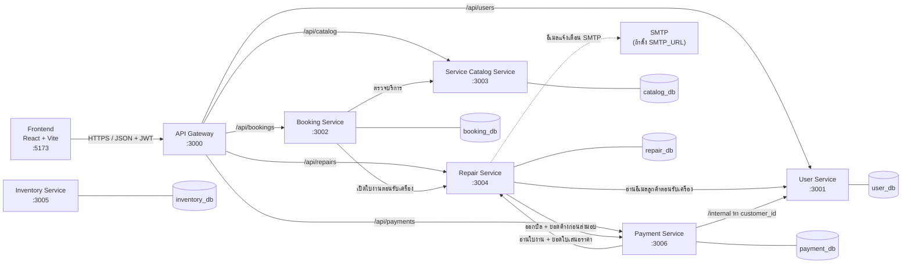
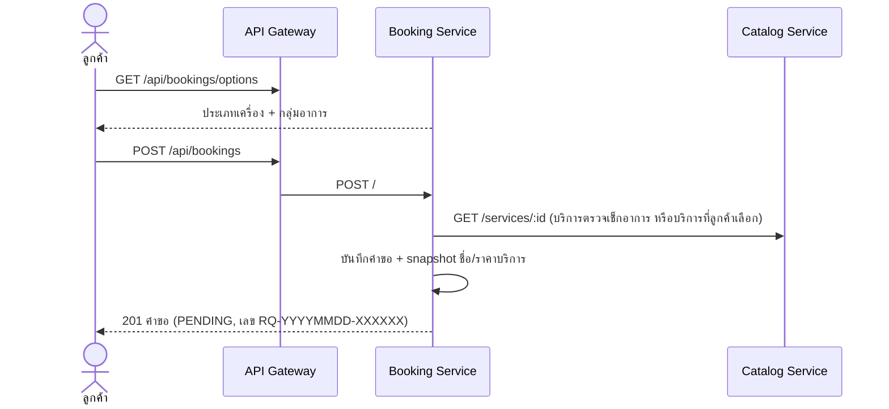

# Com-tle — SmartFix

รายชื่อ (รายละเอียดดูที่ [ผู้พัฒนา / Developers](#ผู้พัฒนา--developers))

- นาย รัชภูมิ ธรรมประชา 67159224
- นาย ศิวากร แทนทรัพย์ 67128056
- นาย สุรวุฒิ บุญยู้ 67144643

ระบบจัดการร้านซ่อมคอมพิวเตอร์และโน้ตบุ๊ก ออกแบบเป็น Microservices: ลูกค้าเดินเข้าร้าน หรือแจ้งซ่อมล่วงหน้าทางเว็บ (บอกเครื่องและอาการ ไม่ต้องนัดเวลา) ร้านรับเครื่องแล้วเปิดใบงาน ช่างกดรับงานจากคิว ตรวจเช็กแล้วเสนอหลายตัวเลือกพร้อมราคา (รวม "ไม่ซ่อม" ค่าตรวจ ฿300) ลูกค้าเลือกและชำระเงินออนไลน์ได้ ได้รับแจ้งเตือนในเว็บและอีเมล และมีรับประกัน 90 วันหลังส่งมอบ

## Architecture

### ภาพรวม



- **ทุกคำขอจาก Frontend ผ่าน API Gateway จุดเดียว:** Gateway ส่งต่อเฉพาะ Endpoint ที่อยู่ใน allowlist ถ้าไม่อยู่ในรายการจะตอบ `404 API endpoint not found` (เช่น `/internal/...` เรียกจากภายนอกไม่ได้)
- **แต่ละบริการมีฐานข้อมูลของตัวเอง (Database per Service):** ใช้ MySQL 8 บน Railway บริการหนึ่งไม่อ่านตารางของอีกบริการโดยตรง ถ้าต้องใช้ข้อมูลข้ามบริการจะเรียกผ่าน HTTP API โดยส่งโทเคนของผู้เรียกต่อไปด้วย ปลายทางจึงตรวจสิทธิ์เองได้
- **ยืนยันตัวตนด้วย JWT (RS256):**
  - User Service เซ็นโทเคนด้วย private key (อายุ access token 15 นาที, refresh token 30 วันและหมุนทุกครั้งที่ใช้)
  - ทุกบริการตรวจโทเคนเองด้วย public key และตัดสินสิทธิ์จากบทบาทในโทเคน ไม่ต้องถาม User Service ทุกครั้ง
  - 1 บัญชีมี 1 บทบาท: `CUSTOMER`, `TECHNICIAN` หรือ `ADMIN`
- **เทคโนโลยี:** Node.js + Express, knex (migration/query), zod (validate input), jsonwebtoken, http-proxy-middleware (Gateway)

### หน้าที่ของแต่ละบริการ

| บริการ | Port | ฐานข้อมูล | หน้าที่ |
|---|---|---|---|
| API Gateway | 3000 | – | จุดเข้าเดียวของระบบ: ส่งต่อคำขอไปบริการที่ถูกต้อง, กรอง Endpoint ด้วย allowlist, จำกัดจำนวนครั้งการ login |
| User Service | 3001 | `user_db` | สมัครสมาชิก, เข้าสู่ระบบ, ออก/ต่ออายุ/ยกเลิกโทเคน, โปรไฟล์, บทบาทและสิทธิ์ (RBAC), ผู้ดูแลจัดการบัญชี (เปิด/ปิดบัญชี, เปลี่ยนบทบาท 1 บัญชี 1 บทบาท), รวมบัญชีลูกค้าที่ซ้ำ |
| Booking Service | 3002 | `booking_db` | แจ้งซ่อมล่วงหน้า (เครื่อง + กลุ่มอาการ ไม่มีการเลือกเวลา) ได้เลข RQ, หน้าร้านค้นจากเลข RQ หรือเบอร์โทร, ยกเลิก พร้อมเก็บประวัติสถานะ, รับเครื่อง (check-in) แล้วสั่งเปิดใบงานซ่อม |
| Service Catalog Service | 3003 | `catalog_db` | หมวดบริการและรายการบริการ พร้อมราคาเริ่มต้น (บาท) และเวลาโดยประมาณ, เปิด/ปิดบริการ, บันทึก audit log ทุกการแก้ไข |
| Repair Service | 3004 | `repair_db` | ใบงานซ่อม (Work Order) ทั้งจากคำขอแจ้งซ่อมและ walk-in, คิวงานรอช่าง (ช่างกดรับเอง) และมอบหมายช่าง, วินิจฉัย, ใบเสนอราคา (ส่ง/แก้ไข/ลูกค้าตัดสินใจ), ซ่อม, ทดสอบ, ส่งมอบ (เช็กยอดค้างกับ Payment), ยกเลิก, คลังอะไหล่และการเบิก |
| Inventory Service | 3005 | `inventory_db` | คลังอะไหล่ (โครงพร้อมแล้ว ยังไม่เปิดผ่าน Gateway ตอนนี้ Repair Service ดูแลอะไหล่) |
| Payment Service | 3006 | `payment_db` | บิลตามใบงาน, รับชำระที่ร้าน (แบ่งจ่ายได้), **ชำระออนไลน์** (PromptPay/บัตร แบบจำลอง), ยอดค้างชำระ, ล็อกการชำระ, ยกเลิกรายการชำระ, คืนเงินแบบ 2 คน (ขอ → อนุมัติ → ดำเนินการ) |

### เส้นทางข้อมูล

**1. เข้าสู่ระบบ**

```
Frontend → POST /api/users/auth/login → Gateway (rate limit) → User Service
         ← access token (JWT, 15 นาที) + refresh token (30 วัน)
```

Frontend แนบ `Authorization: Bearer <token>` ในทุกคำขอต่อจากนี้ ถ้า access token หมดอายุ Frontend ขอโทเคนใหม่ด้วย refresh token ให้อัตโนมัติ แล้วพาไปหน้าตามบทบาท: ลูกค้า → `/my/bookings`, ช่าง → `/tech`, ผู้ดูแล → `/admin`

**2. ลูกค้าแจ้งซ่อมล่วงหน้า (ไม่บังคับ)**



- ไม่มีการเลือกวันเวลา ไม่มีมัดจำ ไม่มี no-show ลูกค้าบอกแค่เครื่อง กลุ่มอาการ รายละเอียด และเบอร์ติดต่อ
- ถ้าลูกค้าไม่เลือกบริการ คำขอจะเป็นของบริการ "ตรวจเช็กอาการ" (`REQUEST_DIAGNOSIS_SERVICE_ID`, ค่าเริ่มต้นคือ seed HW-DIAG)
- ลูกค้าหนึ่งคนมีคำขอที่ยังเปิดอยู่ได้ไม่เกิน `REQUEST_MAX_OPEN_PER_CUSTOMER` รายการ (ค่าเริ่มต้น 5)

**3. ลูกค้านำเครื่องมาที่ร้าน**

```
หน้าร้าน  ผู้ดูแล → GET /api/bookings?search=RQ-20261119-...   หรือ ?search=0812345678 (เบอร์โทร)
รับเครื่อง ผู้ดูแล → POST /api/bookings/:id/check-in  { accessories, intake_terms_acknowledged }
             Booking Service → POST Repair Service /work-orders  (Idempotency-Key: booking-<id>)
             ← work_order_id                                       (PENDING → COMPLETED)

ยกเลิก     ลูกค้า (เมื่อไรก็ได้ระหว่างที่ยังเปิดอยู่) หรือผู้ดูแล (ต้องมีเหตุผล) → PATCH /api/bookings/:id/cancel
```

- กติกา 1 คำขอ = 1 ใบงาน ถ้า Repair Service ล่ม คำขอจะยังเปิดอยู่แล้วลองใหม่ได้ ไม่เกิดใบงานซ้ำเพราะใช้ Idempotency-Key เดิม
- สัญญากับ Repair ยังใช้ชื่อ `booking_id`, `booking_number` เหมือนเดิม และส่ง `scheduled_at` เป็นเวลาที่ลูกค้าแจ้งซ่อม (คำขอไม่มีเวลานัด)
- ลูกค้าที่ walk-in เข้ามาที่ร้านจะเปิดใบงานตรงที่ `POST /api/repairs/work-orders/walk-in`
- คำขอที่ไม่มีใครนำเครื่องมาภายใน 30 วัน booking-service ปิดเองเป็น `EXPIRED`

**4. ช่างรับงานจากคิว**

```
ช่าง → GET  /api/repairs/work-orders/queue          เครื่องที่รับแล้วแต่ยังไม่มีช่างรับ (รอนานสุดก่อน)
ช่าง → POST /api/repairs/work-orders/:id/claim      รับงาน ใครกดก่อนได้ก่อน (มีคนรับแล้ว 409)
ผู้ดูแล → POST /api/repairs/work-orders/:id/assign  มอบหมายหรือเปลี่ยนช่างเองก็ได้
```

**5. ตรวจเช็ก → เสนอตัวเลือก → ซ่อม → ชำระเงิน → ส่งมอบ**

```
ช่างเริ่มตรวจเช็ก → บันทึกผลตรวจ → ส่งตัวเลือกพร้อมราคา 1-5 แบบให้ลูกค้า (ระบบเพิ่ม "ไม่ซ่อม" ค่าตรวจ ฿300 ให้เอง)
ลูกค้าเลือกบนเว็บ (ลูกค้า walk-in ผู้ดูแลบันทึกให้)
  ├─ ไม่ซ่อม → รอรับเครื่อง (บิล ฿300)
  └─ ซ่อม → (รออะไหล่) → ซ่อม (ร้านเบิกอะไหล่ตามที่เลือก) → บันทึกผล → ทดสอบ (ไม่ผ่าน = กลับไปซ่อม) → รอรับเครื่อง
เจองานเพิ่มระหว่างซ่อม → ส่งตัวเลือกงานเพิ่ม (มี "ไม่ทำงานเพิ่ม" ฿0 ให้เลือก) งานเดิมทำต่อ
รอรับเครื่องเก็บฟรี 7 วัน เกินแล้ว Dashboard ขึ้นรายการให้โทรตาม
ยอดค้าง = ราคาตัวเลือกที่เลือก − ที่จ่ายแล้ว + ที่คืนไป
ลูกค้าจ่ายออนไลน์ (POST /api/payments/checkout) หรือผู้ดูแลรับชำระที่ร้าน (แบ่งจ่ายได้)
ผู้ดูแลส่งมอบ → Repair Service อัปเดตบิลแล้วถามยอดค้างจาก Payment (ยังค้าง = ต้องระบุเหตุผลข้อยกเว้น)
ส่งมอบแล้ว → รับประกัน 90 วัน อาการเดิมกลับมา = ผู้ดูแลเปิดใบงานเคลม (POST /api/repairs/work-orders/:id/warranty-claims) ราคา ฿0
```

ทุกขั้นสำคัญ (รับเครื่อง, ส่งตัวเลือก, รออะไหล่, พร้อมรับเครื่อง, ส่งมอบ, เปิดเคลม, ยกเลิก) แจ้งลูกค้าที่มีบัญชีในเว็บและทางอีเมล ดูหัวข้อ [การแจ้งเตือนลูกค้า](#การแจ้งเตือนลูกค้า-ข้อ-13)

**6. คืนเงิน (ต้องใช้ผู้ดูแล 2 คน)**

```
ผู้ดูแล A → POST /api/payments/refunds                       ขอคืนเงิน (REQUESTED)
ผู้ดูแล B → POST /api/payments/refunds/:id/approve           อนุมัติ (คนขออนุมัติเองไม่ได้)
ผู้ดูแล B → POST /api/payments/refunds/:id/execute           ยืนยันว่าโอนคืนแล้ว (COMPLETED) ยอดในใบงานจึงเปลี่ยน
```

**7. ถ้ามีบริการล่ม (Fault isolation)**

| บริการที่ล่ม | ผล |
|---|---|
| User Service | ผู้ใช้ที่ login อยู่ยังใช้งานได้ทุกอย่างรวมถึงเรื่องเงินจนโทเคนหมดอายุ (15 นาที) เพราะทุกบริการตรวจโทเคนเอง แต่ login ใหม่ไม่ได้ |
| Payment Service | หน้าใบงานและ Dashboard ยังเปิดได้ ส่วนการเงินแสดงว่า "ไม่พร้อมใช้งาน" |
| Catalog / Booking / Repair | เฉพาะฟีเจอร์ที่ต้องใช้บริการนั้นตอบ error ที่อ่านเข้าใจได้ ส่วนอื่นใช้งานต่อได้ |
| API Gateway | ใช้งานไม่ได้ทั้งระบบ (จุดเข้าเดียว) ระบบจริงแก้ด้วยการรันหลายตัวหลัง load balancer |

## API implementation

ทุก Endpoint เรียกผ่าน Gateway ที่ `http://localhost:3000/api` ตอบกลับเป็น JSON รูปแบบ `{ "success": true, "data": ... }` หรือ `{ "success": false, "message": "..." }` Endpoint ที่ต้อง login ให้แนบ `Authorization: Bearer <access token>` คำขอที่เกี่ยวกับเงิน (`POST /api/payments`, `/checkout`, `/refunds`) ต้องแนบ `Idempotency-Key` เพื่อกันจ่ายซ้ำ

HTTP Methods ที่ใช้:

| Method | ใช้เมื่อ |
|---|---|
| `GET` | อ่านข้อมูล |
| `POST` | สร้างข้อมูลใหม่ หรือสั่งให้เกิดเหตุการณ์ เช่น check-in, ชำระเงิน, ช่างรับงานจากคิว, เปิดใบงานเคลม, คืนเงิน |
| `PUT` | บันทึกหรือแทนที่ข้อมูลทั้งก้อน เช่น ผลวินิจฉัย, ตั้งบทบาท |
| `PATCH` | แก้บางส่วน หรือเปลี่ยนสถานะ เช่น ยกเลิกคำขอแจ้งซ่อม, แก้โปรไฟล์, เปิด/ปิดบริการ |
| `DELETE` | ลบความสัมพันธ์ เช่น ถอนบทบาทของผู้ใช้ |

### User Service — `/api/users`

| Method | Endpoint | ผู้ใช้ | คำอธิบาย |
|---|---|---|---|
| POST | `/api/users/auth/register` | ทุกคน | สมัครสมาชิก (ได้บทบาท CUSTOMER) |
| POST | `/api/users/auth/login` | ทุกคน | เข้าสู่ระบบ ได้ access + refresh token |
| POST | `/api/users/auth/refresh` | ผู้ใช้ | ขอ access token ใหม่ (refresh token เดิมใช้ซ้ำไม่ได้) |
| POST | `/api/users/auth/logout` | ผู้ใช้ | ออกจากระบบ (ยกเลิก refresh token) |
| GET | `/api/users/users/me` | ผู้ใช้ | ดูโปรไฟล์ตัวเอง |
| PATCH | `/api/users/users/me` | ผู้ใช้ | แก้โปรไฟล์ตัวเอง |
| GET | `/api/users/users/me/permissions` | ผู้ใช้ | ดูสิทธิ์ของตัวเอง |
| GET | `/api/users/admin/users` | ADMIN | รายชื่อผู้ใช้ (กรองด้วย `role`, `status`, `search`) |
| GET | `/api/users/admin/users/:userId` | ADMIN | ดูผู้ใช้หนึ่งคน |
| PATCH | `/api/users/admin/users/:userId/status` | ADMIN | เปิด/ปิดบัญชี |
| PUT | `/api/users/admin/users/:userId/roles/:roleCode` | ADMIN | ตั้งบทบาท CUSTOMER หรือ TECHNICIAN (แทนที่บทบาทเดิม เปลี่ยนบัญชีผู้ดูแลไม่ได้) |
| DELETE | `/api/users/admin/users/:userId/roles/:roleCode` | ADMIN | ถอนบทบาท (ถอนบทบาทสุดท้ายไม่ได้) |
| POST | `/api/users/admin/customer-merge-requests` | ADMIN | ขอรวมบัญชีลูกค้าที่ซ้ำกัน |
| POST | `/api/users/admin/customer-merge-requests/:requestId/approve` | ADMIN | อนุมัติการรวมบัญชี |
| POST | `/api/users/admin/customer-merge-requests/:requestId/reject` | ADMIN | ปฏิเสธการรวมบัญชี |
| POST | `/api/users/admin/customer-merge-requests/:requestId/cancel` | ADMIN | ยกเลิกคำขอรวมบัญชี |

Endpoint ภายใน (เรียกได้เฉพาะระหว่างบริการด้วยโทเคนภายใน ไม่ผ่าน Gateway): `POST /internal/customers/resolve` (Payment ใช้หา `customer_id` ของลูกค้า), `POST /internal/permissions/check`

### Booking Service — `/api/bookings`

| Method | Endpoint | ผู้ใช้ | คำอธิบาย |
|---|---|---|---|
| GET | `/api/bookings/options` | CUSTOMER / ADMIN | ตัวเลือกของฟอร์ม: `device_types`, `symptom_groups` |
| POST | `/api/bookings` | CUSTOMER | แจ้งซ่อมล่วงหน้า (`device_type`, `symptom_group`, `reported_symptom`, `contact_name`, `contact_phone`, ยี่ห้อ/รุ่น/S/N, `service_id` ไม่บังคับ) ได้สถานะ PENDING |
| GET | `/api/bookings/me` | CUSTOMER | คำขอของฉัน |
| GET | `/api/bookings?search=...` | ADMIN | คำขอทั้งหมด กรองสถานะ/วันที่ได้ และค้นด้วยเลข RQ หรือเบอร์โทร |
| GET | `/api/bookings/:bookingId` | เจ้าของ / ADMIN | รายละเอียดคำขอ + ประวัติสถานะ |
| PATCH | `/api/bookings/:bookingId/cancel` | เจ้าของ / ADMIN (ต้องมีเหตุผล) | ยกเลิกคำขอที่ยังเปิดอยู่ |
| POST | `/api/bookings/:bookingId/check-in` | ADMIN | รับเครื่องและเปิดใบงานซ่อม (PENDING → COMPLETED) |

สถานะ: `PENDING` (รอนำเครื่องมา) → `COMPLETED` (รับเครื่องแล้ว) / `CANCELLED` / `EXPIRED` (ไม่มีใครนำเครื่องมา ปิดอัตโนมัติ) การจองแบบเก่า (`CONFIRMED`) ยังรับเครื่องหรือยกเลิกได้ ส่วน `NO_SHOW` จบแล้ว

สถานะคำขอแจ้งซ่อม:

```
แจ้งซ่อม ──> PENDING ──check-in──> COMPLETED   (เปิดใบงานซ่อม)
                │
                ├──ยกเลิก (ลูกค้า หรือร้านพร้อมเหตุผล)──> CANCELLED
                └──ไม่มีใครนำเครื่องมาใน 30 วัน (อัตโนมัติ)──> EXPIRED
```

(ข้อมูลจากระบบจองคิวเดิม: `CONFIRMED` ยังรับเครื่องหรือยกเลิกได้, `NO_SHOW` จบแล้ว ส่วน `AWAITING_DEPOSIT` จากระบบมัดจำเดิมถูกเปลี่ยนเป็น `CANCELLED` ตอน migration แล้ว)

### Service Catalog Service — `/api/catalog`

| Method | Endpoint | ผู้ใช้ | คำอธิบาย |
|---|---|---|---|
| GET | `/api/catalog/categories` | ทุกคน | หมวดบริการ |
| POST | `/api/catalog/categories` | ADMIN | เพิ่มหมวด |
| PATCH | `/api/catalog/categories/:categoryId` | ADMIN | แก้ชื่อ/รายละเอียดหมวด |
| PATCH | `/api/catalog/categories/:categoryId/status` | ADMIN | เปิด/ปิดหมวด |
| GET | `/api/catalog/services` | ทุกคน | รายการบริการ (ลูกค้าเห็นเฉพาะที่เปิดอยู่) |
| GET | `/api/catalog/services/:serviceId` | ทุกคน | รายละเอียดบริการ |
| POST | `/api/catalog/services` | ADMIN | เพิ่มบริการ (ราคาเริ่มต้นเป็นบาท, เวลาโดยประมาณ) |
| PATCH | `/api/catalog/services/:serviceId` | ADMIN | แก้บริการ |
| PATCH | `/api/catalog/services/:serviceId/status` | ADMIN | เปิด/ปิดบริการ |
| GET | `/api/catalog/audit-logs` | ADMIN | ประวัติการแก้ไขแค็ตตาล็อก |

### Repair Service — `/api/repairs`

| Method | Endpoint | ผู้ใช้ | คำอธิบาย |
|---|---|---|---|
| POST | `/api/repairs/work-orders` | Booking Service / ADMIN | เปิดใบงานจากคำขอแจ้งซ่อม (ใบงานเข้าคิวงานรอช่าง) |
| POST | `/api/repairs/work-orders/walk-in` | ADMIN | เปิดใบงานลูกค้า walk-in |
| GET | `/api/repairs/work-orders` | ADMIN | ใบงานทั้งหมด |
| GET | `/api/repairs/work-orders/me` | CUSTOMER | ใบงานของฉัน |
| GET | `/api/repairs/work-orders/assigned` | TECHNICIAN | งานที่ได้รับมอบหมาย |
| GET | `/api/repairs/work-orders/queue` | TECHNICIAN / ADMIN | คิวงานรอช่าง: เครื่องที่รับแล้วแต่ยังไม่มีช่างรับ (รอนานสุดก่อน) |
| POST | `/api/repairs/work-orders/:workOrderId/claim` | TECHNICIAN | ช่างรับงานจากคิวเอง ใครกดก่อนได้ก่อน (มีคนรับแล้ว 409) |
| POST | `/api/repairs/work-orders/:workOrderId/warranty-claims` | ADMIN | อาการเดิมกลับมาในระยะประกัน (90 วันหลังส่งมอบ): เปิดใบงานเคลมผูกกับใบเดิม ทุกตัวเลือกในใบเสนอราคาเป็น ฿0 เปิดได้ครั้งละ 1 ใบ |
| GET | `/api/repairs/work-orders/:workOrderId` | ผู้เกี่ยวข้อง | รายละเอียดใบงาน |
| POST | `/api/repairs/work-orders/:workOrderId/assign` | ADMIN | มอบหมาย/เปลี่ยนช่าง |
| POST | `/api/repairs/work-orders/:workOrderId/diagnosis/start` | TECHNICIAN | เริ่มวินิจฉัย |
| PUT | `/api/repairs/work-orders/:workOrderId/diagnosis` | TECHNICIAN | บันทึกผลวินิจฉัย |
| POST | `/api/repairs/work-orders/:workOrderId/quotations` | TECHNICIAN | ส่งตัวเลือกพร้อมราคา 1-5 แบบให้ลูกค้า (ระบบเพิ่มตัวเลือก "ไม่ซ่อม" ให้เอง) |
| POST | `/api/repairs/quotations/:quotationId/decision` | CUSTOMER / ADMIN (walk-in) | เลือก 1 ตัวเลือก `{ option_id, note? }` |
| POST | `/api/repairs/work-orders/:workOrderId/parts/wait` | TECHNICIAN | ตั้งสถานะรออะไหล่ `{ note }` |
| POST | `/api/repairs/work-orders/:workOrderId/repair/start` | TECHNICIAN | เริ่มซ่อม (จาก "อนุมัติแล้ว" หรือ "รออะไหล่") |
| PUT | `/api/repairs/work-orders/:workOrderId/repair/result` | TECHNICIAN | บันทึกผลการซ่อม |
| POST | `/api/repairs/work-orders/:workOrderId/tests` | TECHNICIAN | บันทึกผลทดสอบ (ไม่ผ่าน = กลับไปซ่อม) |
| POST | `/api/repairs/work-orders/:workOrderId/bill` | ADMIN | ให้ Repair คำนวณยอดจากใบเสนอราคาที่อนุมัติแล้วออกบิลกับ Payment |
| POST | `/api/repairs/work-orders/:workOrderId/handover` | ADMIN | ส่งมอบเครื่องคืนลูกค้า (อัปเดตบิล แล้วตรวจยอดค้างกับ Payment) |
| POST | `/api/repairs/work-orders/:workOrderId/cancel` | ADMIN | ยกเลิกใบงาน |
| GET | `/api/repairs/parts` | ADMIN / TECHNICIAN | รายการอะไหล่และจำนวนคงเหลือ |
| POST | `/api/repairs/parts` | ADMIN | เพิ่มอะไหล่ |
| POST | `/api/repairs/parts/:partId/receive` | ADMIN | รับอะไหล่เข้าสต็อก |
| GET | `/api/repairs/parts/movements` | ADMIN | ประวัติการเคลื่อนไหวอะไหล่ |
| POST | `/api/repairs/work-orders/:workOrderId/parts/issue` | ADMIN | เบิกอะไหล่ใช้กับใบงาน (เฉพาะรายการที่ลูกค้าอนุมัติ, ช่างเป็นคนเสนอ) |
| GET | `/api/repairs/notifications/me` | CUSTOMER | การแจ้งเตือนของฉัน 50 รายการล่าสุด + จำนวนที่ยังไม่อ่าน |
| POST | `/api/repairs/notifications/me/read` | CUSTOMER | อ่านแล้ว `{ ids?: [uuid] }` (ไม่ส่ง ids = อ่านทั้งหมด) |

#### ใบเสนอราคาแบบหลายตัวเลือก

ช่างส่ง (ไม่ต้องให้ร้านตั้งราคาก่อน):

```json
POST /api/repairs/work-orders/:workOrderId/quotations
{
  "note": "SSD เสีย ทำให้เปิดเครื่องไม่ขึ้น",
  "options": [
    {
      "title": "เปลี่ยน SSD 512GB",
      "description": "เปิดได้และเร็วขึ้น รับประกัน 90 วัน",
      "items": [
        { "type": "PART", "description": "SSD 512GB", "part_id": "<uuid>", "qty": 1, "unit_price": 1290 },
        { "type": "LABOR", "description": "ค่าแรง", "qty": 1, "unit_price": 500 }
      ]
    }
  ]
}
```

- ใบแรก (`kind: INITIAL`) ระบบเพิ่มตัวเลือก `NO_REPAIR` "ไม่ซ่อม รับเครื่องคืน" ราคา `NO_REPAIR_FEE` (ค่าเริ่มต้น ฿300)
- งานเพิ่มระหว่างซ่อม (`kind: ADDITIONAL`) ระบบเพิ่มตัวเลือก `SKIP_EXTRA` "ไม่ทำงานเพิ่ม" ราคา ฿0
- ใบงานที่ได้กลับมา `quotations[].options[]` มี `option_id`, `kind` (`REPAIR` / `NO_REPAIR` / `SKIP_EXTRA`), `title`, `description`, `total`, `items[]` และ `quotations[].selected_option_id`
- เมื่อลูกค้าเลือก รายการของตัวเลือกนั้นจะกลายเป็น `items` ของใบเสนอราคาที่ `APPROVED` (`total` = ราคาตัวเลือก) Payment จึงคิดยอดจากใบที่ `APPROVED` ได้เหมือนเดิม
- เลือก `NO_REPAIR` → ใบงานไปที่ "รอรับเครื่อง" ทันที, `repair_declined: true`, ส่งมอบได้โดยไม่ต้องทดสอบ
- เลือก `SKIP_EXTRA` → ใบเสนอราคางานเพิ่มเป็น `REJECTED` งานเดิมทำต่อ

#### สถานะใบงานที่ API ส่งออก

`PENDING` → `DIAGNOSING` → `WAITING_APPROVAL` → `APPROVED` → (`WAITING_PARTS`) → `REPAIRING` → `TESTING` → `COMPLETED` (รอรับเครื่อง; ส่งมอบแล้วดูจาก `handed_over_at`) / `CANCELLED`

ใบงานที่รอรับเครื่องมี `pickup: { ready_at, free_until, free_days, overdue, days_overdue }` เก็บฟรี `FREE_STORAGE_DAYS` วัน (ค่าเริ่มต้น 7) เกินแล้ว Dashboard ขึ้นรายการให้โทรตาม (ไม่มีค่าฝากเก็บ)

#### การแจ้งเตือนลูกค้า (ข้อ 13)

Repair Service แจ้งลูกค้าที่มีบัญชีทั้งในเว็บ (กระดิ่งมุมขวาบน และหน้า `/my/notifications`) และทางอีเมล ลูกค้า walk-in ไม่มีบัญชี ร้านโทรแจ้งเอง

| `type` | เมื่อไร |
|---|---|
| `RECEIVED` | รับเครื่องจากคำขอแจ้งซ่อม (check-in) |
| `QUOTATION_SENT` | ช่างส่งตัวเลือกพร้อมราคา (รวมงานเพิ่ม) |
| `WAITING_PARTS` | ตั้งสถานะรออะไหล่ |
| `READY_FOR_PICKUP` | ทดสอบผ่าน พร้อมรับเครื่อง (บอกจำนวนวันเก็บฟรี) |
| `HANDED_OVER` | ส่งมอบแล้ว (บอกระยะรับประกัน) |
| `CLAIM_OPENED` | เปิดใบงานเคลม |
| `CANCELLED` | ยกเลิกงานซ่อม |

รูปแบบข้อความ: `{ notification_id, type, work_order_id, title, message, email_status, read_at, created_at }`

- อีเมลลูกค้าเก็บไว้ใน `work_orders.customer_email` ตอน check-in (อ่านจาก User Service ด้วย token ของแอดมินที่รับเครื่อง)
- ส่งอีเมลผ่าน SMTP เมื่อตั้ง `SMTP_URL` ใน `.env` ของ repair-service ถ้าไม่ตั้ง จะแจ้งเฉพาะในเว็บ (`email_status: NOT_CONFIGURED`)
- การแจ้งเตือนล้มเหลวไม่ทำให้ขั้นตอนซ่อมล้มเหลว (เขียน log อย่างเดียว)

### Payment Service — `/api/payments`

| Method | Endpoint | ผู้ใช้ | คำอธิบาย |
|---|---|---|---|
| POST | `/api/payments/checkout` | CUSTOMER | ชำระยอดค้างของใบงานออนไลน์ (PromptPay/บัตร แบบจำลอง) |
| POST | `/api/payments/bills` | ADMIN | ออกบิลของใบงาน (ตามใบเสนอราคาที่อนุมัติ) |
| POST | `/api/payments` | ADMIN | บันทึกการชำระที่ร้าน (แบ่งจ่ายได้) |
| GET | `/api/payments` | ADMIN | รายการชำระทั้งหมด |
| GET | `/api/payments/my` | CUSTOMER | บิลและการชำระของฉัน |
| GET | `/api/payments/balances` | ADMIN | ยอดค้างชำระทุกใบงาน |
| GET | `/api/payments/balances/:workOrderId` | ผู้เกี่ยวข้อง | ยอดค้างชำระของใบงาน |
| POST | `/api/payments/work-orders/:workOrderId/lock` | ADMIN | ล็อกการชำระของใบงาน |
| POST | `/api/payments/work-orders/:workOrderId/unlock` | ADMIN | ปลดล็อกการชำระ |
| POST | `/api/payments/:paymentId/void` | ADMIN | ยกเลิกรายการชำระที่บันทึกผิด |
| POST | `/api/payments/refunds` | ADMIN | สร้างคำขอคืนเงิน |
| GET | `/api/payments/refunds` | ADMIN | รายการคำขอคืนเงิน |
| POST | `/api/payments/refunds/:refundId/approve` | ADMIN (ไม่ใช่คนขอ) | อนุมัติคืนเงิน |
| POST | `/api/payments/refunds/:refundId/reject` | ADMIN | ปฏิเสธ / ยกเลิกคำขอคืนเงิน |
| POST | `/api/payments/refunds/:refundId/execute` | ADMIN (ไม่ใช่คนขอ) | ยืนยันว่าโอนคืนแล้ว |

### Inventory Service — `/api/inventory`

ยังไม่มี Endpoint: Gateway ตอบ `404` ทุกเส้นทางใต้ `/api/inventory` ระหว่างนี้จัดการอะไหล่ผ่าน `/api/repairs/parts`

### ตัวอย่างการเรียก

```http
POST http://localhost:3000/api/bookings
Authorization: Bearer <access token>
Content-Type: application/json

{
  "device_type": "NOTEBOOK",
  "brand": "Acer",
  "model": "Aspire 5",
  "symptom_group": "WONT_POWER_ON",
  "reported_symptom": "เปิดไม่ติด ไฟชาร์จไม่ขึ้น",
  "contact_name": "สมชาย ใจดี",
  "contact_phone": "081-234-5678"
}
```

```json
{
  "success": true,
  "data": {
    "booking_id": "b1d0...",
    "booking_number": "RQ-20261119-FAK643",
    "status": "PENDING",
    "contact_phone": "0812345678",
    "service_name": "Hardware Diagnosis",
    "service_starting_price": 300,
    "scheduled_at": null
  }
}
```


## Database

| ฐานข้อมูล | ตารางหลัก |
|---|---|
| `user_db` | `users`, `customers`, `roles`, `user_roles`, `permissions`, `role_permissions`, `refresh_token_sessions`, `audit_logs` |
| `booking_db` | `bookings` (เก็บคำขอแจ้งซ่อม: snapshot บริการ, `symptom_group`, `contact_phone`), `booking_status_history` |
| `catalog_db` | `service_categories`, `services`, `catalog_audit_logs` |
| `repair_db` | `work_orders`, `work_order_devices`, `work_order_status_history`, `work_order_assignments`, `quotations`, `quotation_options`, `quotation_option_items`, `customer_notifications`, `repair_parts_inventory`, `repair_stock_movements` |
| `payment_db` | `payments`, `refunds`, `payment_audit_logs`, `idempotency_records`, `payment_locks`, `inbox_events`, `outbox_events` |

ข้อมูลข้ามบริการเชื่อมด้วย ID และ snapshot (ไม่มี JOIN หรือ Foreign Key ข้ามฐานข้อมูล) ภายในแต่ละบริการใช้ transaction, row lock และ UNIQUE constraint รักษาความถูกต้อง

## วิธีรัน

```bash
cd backend
npm run install:all
node dev.js          # รันทุกบริการ + Gateway (ข้ามบริการที่ไม่มี .env หรือ port ถูกใช้อยู่)

cd ../frontend
npm install
npm run dev          # http://localhost:5173
```

- `frontend/.env` ตั้ง `VITE_USE_MOCK=false` เพื่อต่อ API จริง (ข้อมูลบน Railway) หรือ `true` เพื่อใช้ข้อมูลตัวอย่างที่เก็บในเบราว์เซอร์โดยไม่ต้องรัน backend ทั้งสองโหมดใช้ข้อมูลคนละชุดกัน
- ฐานข้อมูลใหม่ หรือเมื่อมีการเปลี่ยนตาราง: รัน `npx knex migrate:latest` ในโฟลเดอร์ของบริการนั้น (booking-service, repair-service, payment-service, user-service, catalog-service)
- ค่าที่ปรับได้ (repair-service): ระยะรับประกัน `WARRANTY_DAYS` (ค่าเริ่มต้น 90 วัน นับจากวันส่งมอบ เฉพาะงานที่ซ่อม ไม่รวมงานที่เลือกไม่ซ่อมหรือยกเลิก) ใบงานแสดง `warranty` และ `warranty_parent` / `warranty_claims`
- ค่าที่ปรับได้ (booking-service): บริการตั้งต้นของคำขอ `REQUEST_DIAGNOSIS_SERVICE_ID`, คำขอที่เปิดได้ต่อลูกค้า `REQUEST_MAX_OPEN_PER_CUSTOMER`, อายุคำขอก่อนปิดอัตโนมัติ `REQUEST_EXPIRY_DAYS` (ค่าเริ่มต้น 30 วัน booking-service ตรวจทุก `REQUEST_EXPIRY_CHECK_MINUTES` นาที แล้วเปลี่ยนคำขอที่ไม่มีใครนำเครื่องมาเป็น EXPIRED)
- ตาราง/คอลัมน์ของระบบมัดจำที่ถอดออกแล้ว (`deposits`, `deposit_audit_logs`, `bookings.deposit_due_at`) ยังอยู่ในฐานข้อมูลแต่ไม่มีโค้ดใช้ เพราะ migration รันไปแล้ว ถ้าจะลบให้ทำเป็น migration ใหม่

## ผู้พัฒนา / Developers

หน้า `/team` ในเว็บแสดงข้อมูลชุดเดียวกัน แก้ได้ที่ `frontend/src/data/team.js`

| ชื่อ | รหัสนักศึกษา | บทบาท | ส่วนที่รับผิดชอบ | GitHub |
|---|---|---|---|---|
| นาย ศิวากร แทนทรัพย์ (Siwakorn Thaensap) | 67128056 | Tester & Developer | Booking Service, Catalog Service | [Siwakorn1-ai](https://github.com/Siwakorn1-ai) |
| นาย สุรวุฒิ บุญยู้ (Surawut Boonyu) | 67144643 | Lead Developer (หัวหน้าทีม) | Repair Service, Inventory Service | [Best-Boun](https://github.com/Best-Boun) |
| นาย รัชภูมิ ธรรมประชา (Rachapoom Thumpracha) | 67159224 | System Analyst & Developer | User Service, Payment Service | [rachapoomthu-max](https://github.com/rachapoomthu-max) |

อาจารย์ผู้สอน: อาจารย์ ทินภัทร บริรักษ์ (Thinnaphat Borirak) · CSI400 · Department of Computer Science and Software Development Innovation, Sripatum University (SPU) · thinnaphat.bo@spu.ac.th

## License

[MIT](LICENSE) © 2026 SmartFix development team
