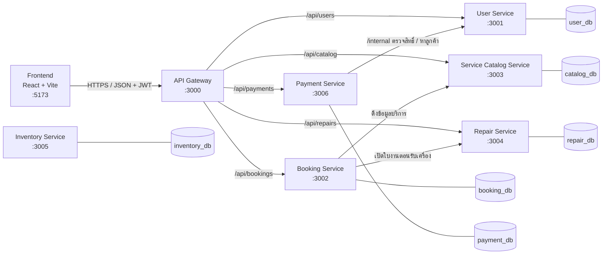
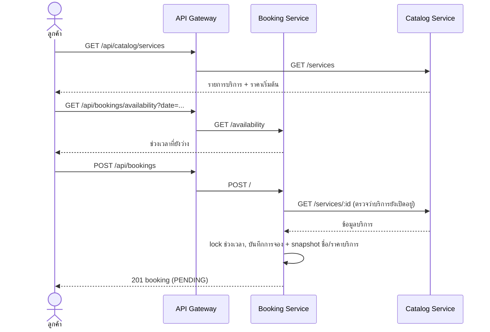

# Com-tle — SmartFix

ระบบจัดการร้านซ่อมคอมพิวเตอร์ ออกแบบเป็น Microservices: ลูกค้าจองคิวออนไลน์ ร้านรับเครื่องและเปิดใบงานซ่อม ช่างวินิจฉัยและซ่อม ร้านออกใบเสนอราคาและรับชำระเงิน

## Architecture

### ภาพรวม



- **ทุกคำขอจาก Frontend ผ่าน API Gateway จุดเดียว:** Gateway ส่งต่อเฉพาะ Endpoint ที่อยู่ใน allowlist ถ้าไม่อยู่ในรายการจะตอบ `404 API endpoint not found`
- **แต่ละบริการมีฐานข้อมูลของตัวเอง (Database per Service):** ใช้ MySQL 8 บน Railway บริการหนึ่งไม่อ่านตารางของอีกบริการโดยตรง ถ้าต้องใช้ข้อมูลข้ามบริการจะเรียกผ่าน HTTP API
- **ยืนยันตัวตนด้วย JWT (RS256):**
  - User Service เซ็นโทเคนด้วย private key
  - บริการอื่นตรวจโทเคนด้วย public key เองได้ ไม่ต้องถาม User Service ทุกครั้ง
  - ในโทเคนมีบทบาท (`roles`): `CUSTOMER`, `TECHNICIAN`, `ADMIN`
- **เทคโนโลยี:** Node.js + Express, knex (migration/query), zod (validate input), jsonwebtoken, http-proxy-middleware (Gateway)

### หน้าที่ของแต่ละบริการ

| บริการ | Port | ฐานข้อมูล | หน้าที่ |
|---|---|---|---|
| API Gateway | 3000 | – | จุดเข้าเดียวของระบบ: ส่งต่อคำขอไปบริการที่ถูกต้อง, กรอง Endpoint ด้วย allowlist, จำกัดจำนวนครั้งการ login |
| User Service | 3001 | `user_db` | สมัครสมาชิก, เข้าสู่ระบบ, ออก/ต่ออายุ/ยกเลิกโทเคน, โปรไฟล์, บทบาทและสิทธิ์, ผู้ดูแลจัดการบัญชี (เปิด/ปิดบัญชี, ให้/ถอนบทบาท), รวมบัญชีลูกค้าที่ซ้ำ |
| Booking Service | 3002 | `booking_db` | ดูช่วงเวลาที่ว่าง, จองคิว (กันจองชนด้วย lock), ยืนยัน/ยกเลิกการจอง พร้อมเก็บประวัติสถานะ, รับเครื่อง (check-in) แล้วสั่งเปิดใบงานซ่อม |
| Service Catalog Service | 3003 | `catalog_db` | หมวดบริการและรายการบริการ พร้อมราคาเริ่มต้น (บาท) และเวลาโดยประมาณ, เปิด/ปิดบริการ, บันทึก audit log ทุกการแก้ไข |
| Repair Service | 3004 | `repair_db` | ใบงานซ่อม (Work Order) ทั้งจากการจองและ walk-in, มอบหมายช่าง, วินิจฉัย, ใบเสนอราคา (ส่ง/แก้ไข/ลูกค้าตัดสินใจ), ซ่อม, ทดสอบ, ส่งมอบ, ยกเลิก, เบิกอะไหล่ |
| Inventory Service | 3005 | `inventory_db` | คลังอะไหล่และสต็อก (โครงพร้อมแล้ว ยังไม่เปิดผ่าน Gateway ตอนนี้ Repair Service ดูแลอะไหล่ไปก่อน) |
| Payment Service | 3006 | `payment_db` | ออกบิลตามใบงาน, รับชำระ (แบ่งจ่ายได้), ยอดค้างชำระ, ล็อก/ปลดล็อกการชำระของใบงาน, ยกเลิกรายการชำระ, คำขอคืนเงิน (อนุมัติ/ปฏิเสธ/ดำเนินการ) |

### เส้นทางข้อมูล

**1. เข้าสู่ระบบ**

```
Frontend → POST /api/users/auth/login → Gateway (rate limit) → User Service
         ← access token (JWT) + refresh token
```

Frontend แนบ `Authorization: Bearer <token>` ในทุกคำขอต่อจากนี้ แต่ละบริการตรวจโทเคนเองด้วย public key จากนั้นระบบพาไปหน้าตามบทบาท: ลูกค้า → `/my/bookings`, ช่าง → `/tech`, ผู้ดูแล → `/admin`

**2. ลูกค้าจองคิว**



Booking Service บันทึกชื่อและราคาบริการไว้กับการจอง (snapshot) ถ้าร้านแก้ราคาทีหลัง การจองเดิมก็ยังแสดงราคาตอนที่จอง

**3. รับเครื่อง → เปิดใบงานซ่อม**

```
ผู้ดูแล → PATCH /api/bookings/:id/confirm         (PENDING → CONFIRMED)
ผู้ดูแล → POST  /api/bookings/:id/check-in
          Booking Service → POST Repair Service /work-orders  (Idempotency-Key: booking-<id>)
          ← work_order_id
          Booking Service บันทึก work_order_id      (CONFIRMED → COMPLETED)
```

กติกา: 1 การจอง = 1 ใบงาน ถ้า Repair Service ล่ม การจองจะยังเป็น CONFIRMED แล้วลองใหม่ได้ ไม่เกิดใบงานซ้ำเพราะใช้ Idempotency-Key เดิม ลูกค้าที่ walk-in เข้ามาที่ร้านจะเปิดใบงานตรงที่ `POST /api/repairs/work-orders/walk-in`

**4. ซ่อม → เสนอราคา → ชำระเงิน**

```
ผู้ดูแลมอบหมายช่าง → ช่างเริ่มวินิจฉัย / บันทึกผล → ออกใบเสนอราคา → ส่งให้ลูกค้า
ลูกค้าอนุมัติ/ปฏิเสธ (แก้ใบเสนอราคาเป็นฉบับใหม่ได้) → ช่างซ่อม + เบิกอะไหล่ → บันทึกผลซ่อม → ทดสอบ
ผู้ดูแลออกบิล (Payment Service) → ลูกค้าชำระ (แบ่งจ่ายได้) → ส่งมอบเครื่อง (Repair Service)
```

Payment Service เรียก User Service ผ่าน `/internal/...` ด้วยโทเคนภายในของบริการ (internal JWT) เพื่อตรวจสิทธิ์และหาข้อมูลลูกค้า Endpoint `/internal` ไม่เปิดผ่าน Gateway

## API implementation

ทุก Endpoint เรียกผ่าน Gateway ที่ `http://localhost:3000/api` ตอบกลับเป็น JSON รูปแบบ `{ "success": true, "data": ... }` หรือ `{ "success": false, "message": "..." }` Endpoint ที่ต้อง login ให้แนบ `Authorization: Bearer <access token>`

HTTP Methods ที่ใช้:

| Method | ใช้เมื่อ |
|---|---|
| `GET` | อ่านข้อมูล |
| `POST` | สร้างข้อมูลใหม่ หรือสั่งให้เกิดเหตุการณ์ เช่น check-in, ส่งมอบ, คืนเงิน |
| `PUT` | บันทึกหรือแทนที่ข้อมูลทั้งก้อน เช่น ผลวินิจฉัย, ให้บทบาท |
| `PATCH` | แก้บางส่วน หรือเปลี่ยนสถานะ เช่น ยืนยัน/ยกเลิกการจอง, เปิด/ปิดบริการ |
| `DELETE` | ลบความสัมพันธ์ เช่น ถอนบทบาทจากผู้ใช้ |

### User Service — `/api/users`

| Method | Endpoint | ผู้ใช้ | คำอธิบาย |
|---|---|---|---|
| POST | `/api/users/auth/register` | ทุกคน | สมัครสมาชิก (ได้บทบาท CUSTOMER) |
| POST | `/api/users/auth/login` | ทุกคน | เข้าสู่ระบบ ได้ access + refresh token |
| POST | `/api/users/auth/refresh` | ผู้ใช้ | ขอ access token ใหม่ |
| POST | `/api/users/auth/logout` | ผู้ใช้ | ออกจากระบบ (ยกเลิก refresh token) |
| GET | `/api/users/users/me` | ผู้ใช้ | ดูโปรไฟล์ตัวเอง |
| PATCH | `/api/users/users/me` | ผู้ใช้ | แก้โปรไฟล์ตัวเอง |
| GET | `/api/users/users/me/permissions` | ผู้ใช้ | ดูสิทธิ์ของตัวเอง |
| GET | `/api/users/admin/users` | ADMIN | รายชื่อผู้ใช้ (กรองด้วย `role`, `status`, `search`) |
| GET | `/api/users/admin/users/:userId` | ADMIN | ดูผู้ใช้หนึ่งคน |
| PATCH | `/api/users/admin/users/:userId/status` | ADMIN | เปิด/ปิดบัญชี |
| PUT | `/api/users/admin/users/:userId/roles/:roleCode` | ADMIN | ให้บทบาท เช่น ตั้งเป็น TECHNICIAN |
| DELETE | `/api/users/admin/users/:userId/roles/:roleCode` | ADMIN | ถอนบทบาท |
| POST | `/api/users/admin/customer-merge-requests` | ADMIN | ขอรวมบัญชีลูกค้าที่ซ้ำกัน |
| POST | `/api/users/admin/customer-merge-requests/:requestId/approve` | ADMIN | อนุมัติการรวมบัญชี |
| POST | `/api/users/admin/customer-merge-requests/:requestId/reject` | ADMIN | ปฏิเสธการรวมบัญชี |
| POST | `/api/users/admin/customer-merge-requests/:requestId/cancel` | ADMIN | ยกเลิกคำขอรวมบัญชี |

Endpoint ภายใน (เรียกได้เฉพาะระหว่างบริการ ไม่ผ่าน Gateway): `POST /internal/permissions/check`, `POST /internal/customers/resolve`

### Booking Service — `/api/bookings`

| Method | Endpoint | ผู้ใช้ | คำอธิบาย |
|---|---|---|---|
| GET | `/api/bookings/availability?date=YYYY-MM-DD` | ทุกคน | ช่วงเวลาที่ยังว่างของวันนั้น |
| POST | `/api/bookings` | CUSTOMER | จองคิว (บริการ, วันที่, เวลา, อุปกรณ์, อาการ) |
| GET | `/api/bookings/me` | CUSTOMER | การจองของฉัน |
| GET | `/api/bookings` | ADMIN | การจองทั้งหมด (กรองสถานะ/วันที่ได้) |
| GET | `/api/bookings/:bookingId` | เจ้าของ / ADMIN | รายละเอียดการจอง + ประวัติสถานะ |
| PATCH | `/api/bookings/:bookingId/confirm` | ADMIN | ยืนยันการจอง (PENDING → CONFIRMED) |
| PATCH | `/api/bookings/:bookingId/cancel` | เจ้าของ / ADMIN | ยกเลิกการจอง พร้อมเหตุผล |
| POST | `/api/bookings/:bookingId/check-in` | ADMIN | รับเครื่องและเปิดใบงานซ่อม (CONFIRMED → COMPLETED) |

### Service Catalog Service — `/api/catalog`

| Method | Endpoint | ผู้ใช้ | คำอธิบาย |
|---|---|---|---|
| GET | `/api/catalog/categories` | ทุกคน | หมวดบริการ |
| POST | `/api/catalog/categories` | ADMIN | เพิ่มหมวด |
| PATCH | `/api/catalog/categories/:categoryId` | ADMIN | แก้ชื่อ/รายละเอียดหมวด |
| PATCH | `/api/catalog/categories/:categoryId/status` | ADMIN | เปิด/ปิดหมวด |
| GET | `/api/catalog/services` | ทุกคน | รายการบริการ (ลูกค้าเห็นเฉพาะที่เปิดอยู่) |
| GET | `/api/catalog/services/:serviceId` | ทุกคน | รายละเอียดบริการ |
| POST | `/api/catalog/services` | ADMIN | เพิ่มบริการ (ราคาเริ่มต้นเป็นบาท, เวลาโดยประมาณ) |
| PATCH | `/api/catalog/services/:serviceId` | ADMIN | แก้บริการ |
| PATCH | `/api/catalog/services/:serviceId/status` | ADMIN | เปิด/ปิดบริการ |
| GET | `/api/catalog/audit-logs` | ADMIN | ประวัติการแก้ไขแค็ตตาล็อก |

### Repair Service — `/api/repairs`

| Method | Endpoint | ผู้ใช้ | คำอธิบาย |
|---|---|---|---|
| POST | `/api/repairs/work-orders` | Booking Service / ADMIN | เปิดใบงานจากการจอง |
| POST | `/api/repairs/work-orders/walk-in` | ADMIN | เปิดใบงานลูกค้า walk-in |
| GET | `/api/repairs/work-orders` | ADMIN | ใบงานทั้งหมด |
| GET | `/api/repairs/work-orders/me` | CUSTOMER | ใบงานของฉัน |
| GET | `/api/repairs/work-orders/assigned` | TECHNICIAN | งานที่ได้รับมอบหมาย |
| GET | `/api/repairs/work-orders/:workOrderId` | ผู้เกี่ยวข้อง | รายละเอียดใบงาน |
| POST | `/api/repairs/work-orders/:workOrderId/assign` | ADMIN | มอบหมายช่าง |
| POST | `/api/repairs/work-orders/:workOrderId/diagnosis/start` | TECHNICIAN | เริ่มวินิจฉัย |
| PUT | `/api/repairs/work-orders/:workOrderId/diagnosis` | TECHNICIAN | บันทึกผลวินิจฉัย |
| POST | `/api/repairs/work-orders/:workOrderId/quotations` | ADMIN / TECHNICIAN | สร้างใบเสนอราคา |
| PUT | `/api/repairs/quotations/:quotationId/send` | ADMIN | ส่งใบเสนอราคาให้ลูกค้า |
| POST | `/api/repairs/quotations/:quotationId/revise` | ADMIN | แก้ใบเสนอราคา (สร้างฉบับใหม่) |
| POST | `/api/repairs/quotations/:quotationId/decision` | CUSTOMER | อนุมัติ/ปฏิเสธใบเสนอราคา |
| POST | `/api/repairs/work-orders/:workOrderId/repair/start` | TECHNICIAN | เริ่มซ่อม |
| PUT | `/api/repairs/work-orders/:workOrderId/repair/result` | TECHNICIAN | บันทึกผลการซ่อม |
| POST | `/api/repairs/work-orders/:workOrderId/tests` | TECHNICIAN | บันทึกผลทดสอบ |
| POST | `/api/repairs/work-orders/:workOrderId/handover` | ADMIN | ส่งมอบเครื่องคืนลูกค้า |
| POST | `/api/repairs/work-orders/:workOrderId/cancel` | ADMIN | ยกเลิกใบงาน |
| GET | `/api/repairs/parts` | ADMIN / TECHNICIAN | รายการอะไหล่และจำนวนคงเหลือ |
| POST | `/api/repairs/parts` | ADMIN | เพิ่มอะไหล่ |
| POST | `/api/repairs/parts/:partId/receive` | ADMIN | รับอะไหล่เข้าสต็อก |
| GET | `/api/repairs/parts/movements` | ADMIN | ประวัติการเคลื่อนไหวอะไหล่ |
| POST | `/api/repairs/work-orders/:workOrderId/parts/issue` | TECHNICIAN | เบิกอะไหล่ใช้กับใบงาน |

### Payment Service — `/api/payments`

| Method | Endpoint | ผู้ใช้ | คำอธิบาย |
|---|---|---|---|
| POST | `/api/payments/bills` | ADMIN | ออกบิลของใบงาน |
| POST | `/api/payments` | ADMIN | บันทึกการชำระ (แบ่งจ่ายได้) |
| GET | `/api/payments` | ADMIN | รายการชำระทั้งหมด |
| GET | `/api/payments/my` | CUSTOMER | การชำระของฉัน |
| GET | `/api/payments/balances` | ADMIN | ยอดค้างชำระทุกใบงาน |
| GET | `/api/payments/balances/:workOrderId` | ผู้เกี่ยวข้อง | ยอดค้างชำระของใบงาน |
| POST | `/api/payments/work-orders/:workOrderId/lock` | ADMIN | ล็อกการชำระของใบงาน |
| POST | `/api/payments/work-orders/:workOrderId/unlock` | ADMIN | ปลดล็อกการชำระ |
| POST | `/api/payments/:paymentId/void` | ADMIN | ยกเลิกรายการชำระ |
| POST | `/api/payments/refunds` | ADMIN | สร้างคำขอคืนเงิน |
| GET | `/api/payments/refunds` | ADMIN | รายการคำขอคืนเงิน |
| POST | `/api/payments/refunds/:refundId/approve` | ADMIN | อนุมัติคืนเงิน |
| POST | `/api/payments/refunds/:refundId/reject` | ADMIN | ปฏิเสธคืนเงิน |
| POST | `/api/payments/refunds/:refundId/execute` | ADMIN | ดำเนินการคืนเงิน |

### Inventory Service — `/api/inventory`

ยังไม่มี Endpoint: Gateway ตอบ `404` ทุกเส้นทางใต้ `/api/inventory` ระหว่างนี้จัดการอะไหล่ผ่าน `/api/repairs/parts`

### ตัวอย่างการเรียก

```http
POST http://localhost:3000/api/bookings
Authorization: Bearer <access token>
Content-Type: application/json

{
  "service_id": "7f3c2a10-...",
  "appointment_date": "2026-11-20",
  "appointment_time": "10:00",
  "device_type": "โน้ตบุ๊ก",
  "brand": "Acer",
  "model": "Aspire 5",
  "reported_symptom": "เปิดไม่ติด"
}
```

```json
{
  "success": true,
  "data": {
    "booking_id": "b1d0...",
    "booking_number": "BK-20261120-FAK643",
    "status": "PENDING",
    "service_name": "ตรวจเช็กอาการเบื้องต้น",
    "service_starting_price": 300,
    "scheduled_at": "2026-11-20T03:00:00.000Z"
  }
}
```

## วิธีรัน

```bash
cd backend
npm run install:all
node dev.js          # รันทุกบริการ + Gateway

cd ../frontend
npm install
npm run dev          # http://localhost:5173
```

`frontend/.env` ตั้ง `VITE_USE_MOCK=false` เพื่อต่อ API จริง หรือ `true` เพื่อใช้ข้อมูลตัวอย่างโดยไม่ต้องรัน backend
